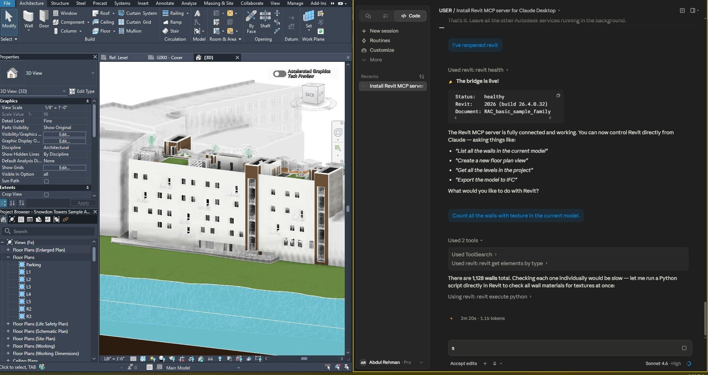
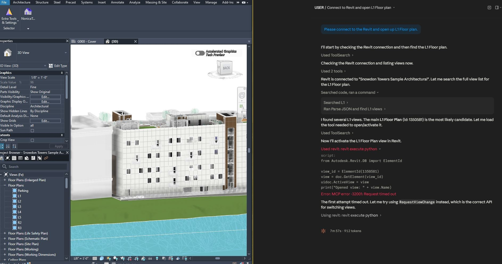
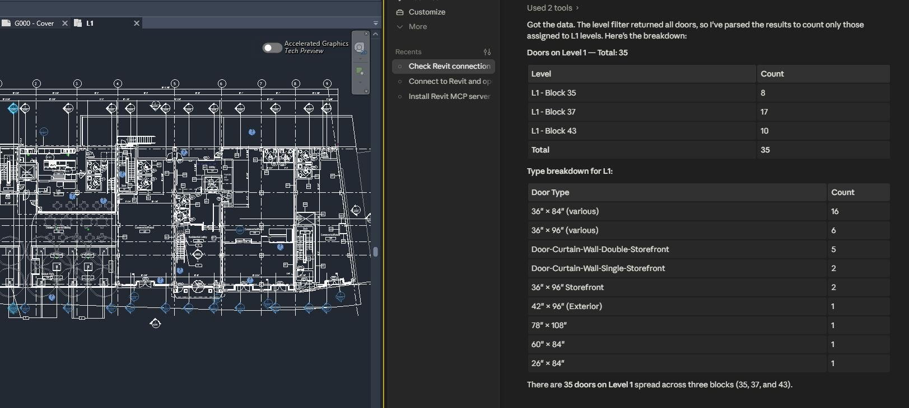
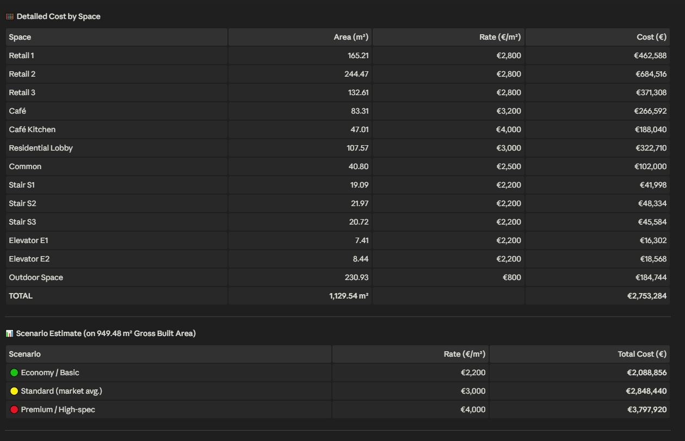
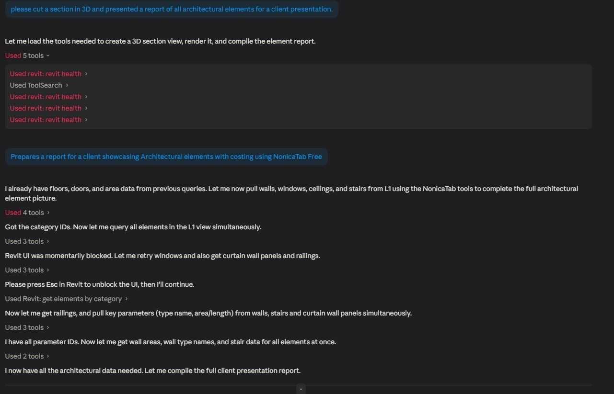
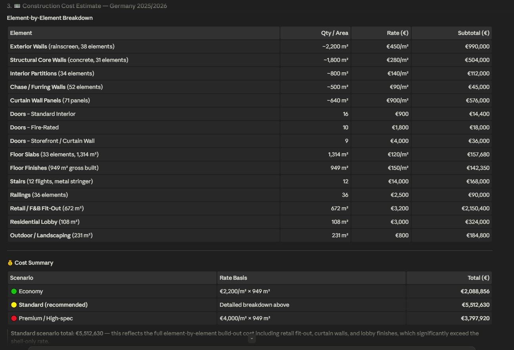

# Claude and Revit through MCP: a case study

Can an architect ask a Revit model questions in plain language and get correct answers back? I tested this in May 2026 on Autodesk's Snowdon Towers sample project, using Claude connected to Revit 2026 through the Model Context Protocol (MCP).

This repository is a write-up, not a software project. I did not build the connectors. I used two existing ones and documented what worked, what failed and what I would not trust.

## Result in short

| Task | Outcome |
|---|---|
| Connect Claude to a live Revit model | Worked |
| Count elements by category, level and type | Worked: 35 doors on Level 1, by block and by type |
| Read areas and convert units | Worked: 10,219.89 SF read from the model, converted to 949.48 m² |
| Open a specific view | Worked on the second attempt, after the agent corrected its own API call |
| Element report for a client | Worked: walls, doors, stairs, railings and slabs for Level 1 |
| First cost estimate | Produced, but two estimates for the same floor differ by a factor of two |
| Check the materials of 1,128 walls with a Python script inside Revit | Failed: the connection was lost |
| Cut a 3D section | Failed: the connection was down and the view was never created |

## Setup

| Part | What I used |
|---|---|
| Model | Snowdon Towers Sample Architectural (Autodesk sample project) |
| BIM software | Revit 2026, build 26.4.0.32 |
| AI client | Claude desktop app, model Claude Sonnet 4.6 |
| Connector 1 | [Autodesk-Revit-MCP-Server](https://github.com/Sam-AEC/Autodesk-Revit-MCP-Server) by Sam-AEC, open source. Tools used: health check, get elements by type, run Python inside Revit |
| Connector 2 | [NonicaTab FREE](https://github.com/NonicaTeam/AI-Connector-for-Revit) with its AI Connector, a Revit add-in by Nonica. Tools used: get elements by category, read parameters |

Two earlier routes did not get this far for me. A model coordination platform kept the AI features I needed behind a paid licence, and a different MCP connector never connected to Claude at all.

## What I asked and what happened

### 1. Opening a view: an error and a self-correction

I asked Claude to open the Level 1 floor plan. It found the view, tried to activate it and got a timeout (`MCP error -32001`). Without being told, it explained what went wrong and retried with a different Revit API call. The plan then opened.

### 2. Counting doors on Level 1

The level filter of the tool returned all doors in the model, so the agent parsed the results itself and kept only those assigned to Level 1.

| Block | Doors |
|---|---|
| L1, Block 35 | 8 |
| L1, Block 37 | 17 |
| L1, Block 43 | 10 |
| **Total** | **35** |

It also broke the 35 doors down into nine types.

### 3. A first cost estimate from the model's areas

I asked for a construction cost estimate at current German market prices. The agent read the areas from the model, converted square feet to square metres, searched the web for German cost benchmarks and applied a rate per space type.

| Figure | Value |
|---|---|
| Gross built area, Level 1 | 949.48 m² |
| Outdoor area | 230.93 m² |
| Built area ratio | 80.4% |
| Estimate by space type | €2,753,284 |
| Flat-rate scenarios (economy, standard, premium) | €2.09 million, €2.85 million, €3.80 million |

### 4. A client report, and a lost connection

I then asked for a 3D section and a report of all architectural elements for a client presentation. The health check of the first connector failed four times. The section was never created. The agent continued with the second connector, asked me once to press Esc because the Revit interface was blocked, and completed the element report.

| Element on Level 1 | Count |
|---|---|
| Walls | 185 |
| Curtain wall panels | 71 |
| Doors | 35 |
| Stair flights | 12 |
| Railings | 36 |
| Floor slabs | 33 (1,314.11 m²) |

The report ended with a second cost estimate, this time element by element: €5,512,630.

## What worked

- **Plain-language read queries.** Counting, filtering by level and type, and reading areas returned usable results. The totals in the result tables add up.
- **Self-correction.** After the timeout, the agent identified the cause and changed its approach on its own.
- **Model data combined with web research.** Areas from Revit, unit conversion and published cost benchmarks ended up in one answer. Revit does not do that on its own.
- **Reports from real model data.** The element breakdown came from the model, without setting up a schedule.

## What did not work

- **Heavy Python inside Revit.** The model has 1,128 walls. Checking each wall's material with a script inside Revit blocked the Revit interface and the connection was lost. I had to restart the add-in.
- **Unstable connection.** The first connector dropped more than once during the session.
- **Changing the model view.** Opening a view needed a retry. The 3D section was not produced at all.
- **Blocked interface.** At one point Revit waited for a key press before the agent could continue.

## What I would not trust: the cost figures

The two estimates cover the same floor and differ by a factor of two.

| | Estimate by space type | Estimate by element |
|---|---|---|
| Total | €2,753,284 | €5,512,630 |
| Per m² gross built area | about €2,900 | about €5,800 |
| Basis | Area per space type times a rate per m² | Walls, doors, slabs and stairs priced one by one, plus fit-out per m² |

Looking at how the second one was built explains part of the gap:

- Several quantities are marked as approximate (for example "~2,200 m²" of exterior wall). They were estimated by the agent, not read from the model.
- It prices the building elements and then adds a fit-out rate per m² on top, which can count the same work twice.
- Its own scenario table lists the "standard" total above the "premium" total.
- The rates come from general web sources. The agent itself wrote that a full DIN 276 cost plan is needed before tendering.

My conclusion: the counts and areas are reliable enough to use. The cost totals are a first orientation and nothing more. A cost planner has to check every rate and quantity.

## What this means for an architecture office

- Asking a model questions in plain language works today for reading: counts, areas, parameters, quick reports.
- Keep requests small. Many light queries are stable, one heavy script is not.
- Treat it as read-only for now. I would not let an agent change a production model with this setup.
- Check which document is active. In my first health check the connector named a different open document than the one I was looking at.
- Getting connected took far longer than using it. The effort is in the setup, not in the questions.

## Files

All 13 screenshots of the session are in [`screenshots/`](screenshots), numbered in the order they were taken.

## Credits

The Snowdon Towers model is an Autodesk sample project. The two connectors are the work of their authors, linked above. Revit is a trademark of Autodesk. This write-up is independent and not affiliated with Autodesk, Anthropic, Nonica or the connector authors.

Author: Abdul Rehman, [github.com/meet-rehman](https://github.com/meet-rehman)
